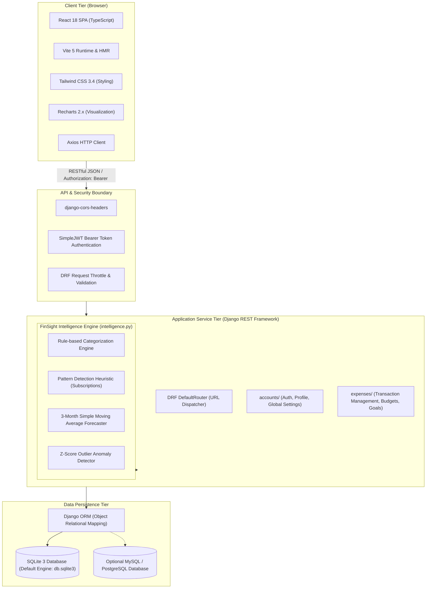
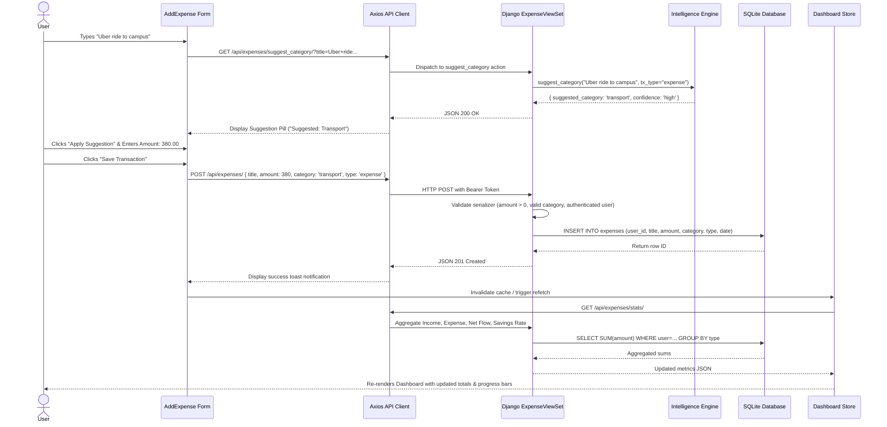

# FinSight — System Architecture Specification

## 1. Architectural Overview

FinSight is engineered as a decoupled, multi-tier web application adhering to the **Model-View-Controller (MVC)** / **Model-View-Template (MVT)** architectural paradigm on the backend and a **Single Page Application (SPA)** reactive component hierarchy on the frontend. Communication between tiers is facilitated via standard JSON-over-HTTPS RESTful endpoints secured through stateless JSON Web Token (JWT) authentication.



---

## 2. Component Responsibilities

### 2.1 Frontend Tier (`src/`)
- **Technology**: React 18, TypeScript 5.5, Vite 5.4, Tailwind CSS, Lucide React, Recharts.
- **Responsibilities**:
  - **State Management & Routing**: Utilizes React Router DOM (`src/App.tsx`) to manage route transitions (`/dashboard`, `/add-expense`, `/history`, `/recurring`, `/reports`, `/settings`).
  - **Asynchronous API Client (`src/services/api.ts`)**: Encapsulates all backend HTTP interactions via Axios. Employs request interceptors to automatically append JWT Bearer tokens stored in `localStorage` and response interceptors to handle 401 Unauthorized token expirations.
  - **Interactive Visualizations**: Modular chart components (`src/components/Charts/`) rendering dynamic SVG visualizations:
    - `CustomBarChart`: Recharts dual-series bar chart for month-by-month Income vs. Expense comparison.
    - `CustomPieChart`: Donut pie chart representing category spending breakdowns.
  - **Reactive Feedback**: Employs `react-hot-toast` for immediate user notifications upon transaction creation, deletion, CSV upload, or budget alterations.

### 2.2 Backend Application Tier (`backend/`)
- **Technology**: Python 3.13, Django 4.2+, Django REST Framework (DRF) 3.14+.
- **Sub-Applications**:
  - `accounts`: Manages user credentials, authentication endpoints (`/api/token/`, `/api/token/refresh/`), customized user profiles (currency preferences, monthly budget limit, alert thresholds), and system settings.
  - `expenses`: Primary domain module housing:
    - `Expense`: Transaction entity supporting both `'expense'` and `'income'` types.
    - `CategoryBudget`: Category-specific monthly budget ceilings.
    - `SavingsGoal`: Financial goal progress tracking with atomic deposit and withdrawal actions.
    - `RecurringExpense`: Automated recurring subscription definitions with next due date calculators.
  - `expenses/intelligence.py`: Pure, testable algorithmic module containing all analytical and heuristic computations.

### 2.3 Data Persistence Tier
- **Technology**: SQLite3 (`db.sqlite3`) as default zero-configuration database; configurable via `DB_ENGINE` to MySQL or PostgreSQL.
- **Responsibilities**:
  - Relational integrity enforced through foreign key constraints (`models.CASCADE`).
  - Unique composite constraints (e.g. `unique_together = ('user', 'category')` on `CategoryBudget`).
  - Transactional persistence guaranteed across system reboots.

---

## 3. Communication Protocols & REST Endpoints

All endpoints are prefixed with `/api/` and require the HTTP header:
```http
Authorization: Bearer <JWT_ACCESS_TOKEN>
```

| HTTP Method | Endpoint URI | Description |
|---|---|---|
| `POST` | `/api/token/` | Authenticate user; returns `access` and `refresh` tokens |
| `GET`, `POST` | `/api/expenses/` | List transactions (with search, category, type filters) / Create transaction |
| `GET`, `PUT`, `DELETE` | `/api/expenses/<id>/` | Retrieve, update, or remove specific transaction |
| `GET` | `/api/expenses/stats/` | Dashboard financial metrics: Total Income, Total Expenses, Net Cash Flow, Savings Rate |
| `GET` | `/api/expenses/forecast/` | Next-month SMA-3 expenditure prediction with backtest accuracy and disclaimers |
| `GET` | `/api/expenses/unusual_spending/` | Statistical Z-score outlier anomaly detection |
| `GET` | `/api/expenses/suggest_category/` | Keyword & token categorization suggestions with confidence scores |
| `POST` | `/api/expenses/import_csv/` | Ingest bank CSV files with duplicate checking |
| `GET` | `/api/expenses/export_csv/` | Export user transactions as downloadable CSV |
| `GET`, `POST` | `/api/category-budgets/` | List and create category budget limits |
| `GET` | `/api/category-budgets/overview/` | Spending progress and warning/danger alerts per category |
| `GET`, `POST` | `/api/savings-goals/` | List and create savings goals |
| `POST` | `/api/savings-goals/<id>/deposit/` | Allocate funds towards a savings goal |
| `POST` | `/api/savings-goals/<id>/withdraw/` | Withdraw funds from a savings goal |
| `GET` | `/api/recurring/detect/` | Run pattern detection heuristic over transaction history |
| `POST` | `/api/recurring/convert_detected/` | Convert detected pattern into an active recurring rule |

---

## 4. End-to-End Data Flow: Creating a Transaction

The sequence diagram below illustrates the life cycle of a transaction from user entry through algorithmic categorization, database persistence, and dashboard update.



---

## 5. Security & Data Integrity

1. **Password Hashing**: Uses Django's default PBKDF2 algorithm with SHA-256 hash stretching.
2. **Stateless JWT Security**: Passwords and sensitive session tokens are never stored in plaintext cookies. Access tokens have configured short lifespans with refresh token rotation.
3. **User Isolation**: All database queries strictly filter by `user=request.user` at the queryset level in DRF viewsets, preventing Horizontal Privilege Escalation (IDOR).
4. **Input Sanitization**: Serializers enforce strict validation:
   - Amounts must be positive (`MinValueValidator(Decimal('0.01'))`).
   - Dates must adhere to valid ISO formats (`YYYY-MM-DD`).
   - Categories must exist within approved enumerated choices.
5. **Division-by-Zero Protection**: All mathematical analytics (savings rates, budget percentages, forecast backtests) employ defensive boundary guards.
